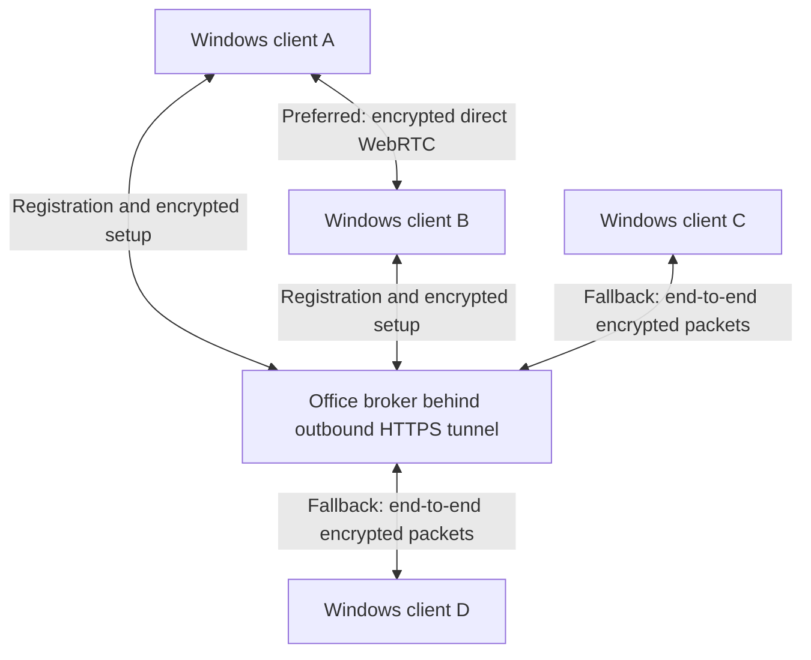

# p2p_Remote_Desktop — 0.4.0 preview

This release implements client-to-client remote desktop with direct P2P first and encrypted relay fallback. It uses a central office broker behind the existing outbound HTTPS tunnel. VPS migration is deferred.

## Run it

1. Run `CampusLinkP2PServer.exe` on the office PC. It automatically starts its private broker and outside tunnel in hidden helper processes. Wait for **Online**, then **Copy server code**. The server does not share the office desktop.
2. Run `p2p_Remote_Desktop.exe` on each Windows x64 PC. Paste the server's CL4 code and click **Join server**. The app remembers the server using Windows user encryption. It displays its server-issued ID and private computer code.
3. On the sharing PC, **Copy my computer code** and send it privately to the connecting person. On their client, paste that code and click **Connect**. A computer code can also join the correct server automatically.
4. On the sharing PC, approve **Yes** for screen plus keyboard/mouse control, **No** for view only, or **Cancel** to decline. Capture starts only after local approval and selection of a transport. Joining the server alone never shares the screen.
5. The session displays **Direct P2P · encrypted** or **Encrypted relay**. Either person can disconnect. A sharing person can revoke control, and an approved direction switch lets either member of the pair share instead.

Each endpoint supports one active desktop session. Separate pairs can connect at the same time through one server. The client needs .NET Framework 4.8 or later, included with Windows 11. Python, Node, a browser, and a tunnel connector are not installed by the client. Its compressed connection libraries are embedded in the executable; it makes no hidden runtime download.

The server must remain online during direct sessions for connection status, acknowledgements and orderly teardown. Closing the client ends its sharing session. Closing the server stops its owned helpers and ends connected sessions. It does not stop unrelated copies of Node or cloudflared.

## Connection path and server roles



The server assigns unique 10-digit IDs and pairs an online target with a requester. It stores an identity hash and ID, binds registration to a private installation credential, and refuses duplicate online identities. It exposes no public device directory. Different pairs are isolated. IDs survive server restarts when both the server registry and client identity are retained.

After key authentication and local approval, ICE checks local and STUN-discovered candidates for up to 10 seconds. The direct path uses a reliable ordered SCTP data channel over DTLS. The default STUN services are `stun.cloudflare.com:3478` and `stun.l.google.com:19302`; STUN discovers reachable addresses and does not carry desktop images. Some NAT/firewall combinations prevent direct UDP connectivity. No inbound port forwarding or TURN deployment is required for the WSS fallback.

When direct connection fails, or an established direct path stops working, the clients use the existing server connection to relay encrypted packets. Numbered envelopes, bounded queues, acknowledgements and replay of unacknowledged packets preserve ordering across the transition. Large frames are split into bounded data-channel chunks and reassembled before decryption. There is no automatic upgrade back to direct within the same session.

On a direct session the broker still forwards small acknowledgements and setup/status traffic, but no desktop images. On a fallback session its uplink and Cloudflare connection carry the images and input. It never decrypts, decodes, records or caches desktop images; relay buffers are transient and bounded. The server does not receive the computer's desktop access key. SDP and ICE candidates are also encrypted with separate signaling key derivation. Desktop packets use the existing directional AES-256-GCM protocol, fresh session salt and replay protection on both paths.

## Temporary address and private state

The current office network has no fixed public entry point. The temporary tunnel's address changes on a server restart, so clients need the new server code. Existing client identities are scoped to the server's persistent credential, rather than the changing URL, so an updated route preserves the device identity. A stable domain/tunnel or VPS will remove this route update later.

Server files live in `%LOCALAPPDATA%\CampusLink`: `p2p-server.json` contains the private membership credential; `p2p-devices.json` contains the hashed identity registry. Client state is protected with Windows DPAPI under `%LOCALAPPDATA%\CampusLink\P2P`. Keep these files and connection codes private. The desktop access key rotates when its client restarts, so its old computer code then stops working. The server code grants membership, and every desktop session still needs the target's separate computer code and local consent.

## Scope and validation

This is a preview with native Windows clients. The old CL3 host/browser release remains separate; its browser viewer does not join CL4 P2P sessions. GDI/JPEG capture, primary monitor, viewing, keyboard/mouse control, live control revocation, quality selection, fullscreen and approved direction switching are supported. The 30/60 fps choices are targets; no sustained end-to-end FPS or 1 Gbps capacity is claimed. There is no audio, file transfer, clipboard synchronization, unattended access or secure/elevated-desktop control.

Automated tests use generated JPEG images and fake input handlers. They exercise real ICE/DTLS/SCTP traffic, fragmented frames, no capture before approval, view-only input rejection, grant/revoke, direct-path interruption and fallback, role reversal, wrong-key rejection, persistent unique IDs and multiple isolated pairs. A direct-only interval checks that the broker's forwarded payload counter does not increase while frames continue arriving. See [validation](VALIDATION.md) for the measured release results. Tests on one Windows PC do not establish connectivity between two physical PCs behind different NATs, Internet throughput, long-duration reliability or security-audit coverage.

Executables are unsigned. The WebRTC dependency is SIPSorcery 10.0.17, with pinned package hashes. Its upstream license includes an additional use restriction; full dependency terms are embedded under **About / licenses** and shipped in `THIRD-PARTY-NOTICES-P2P.txt`. See [dependency notes](THIRD-PARTY.md).

## Build and test

From the prepared checkout:

```powershell
powershell -NoProfile -ExecutionPolicy Bypass -File scripts/build-p2p-client.ps1
powershell -NoProfile -ExecutionPolicy Bypass -File scripts/build-p2p-server.ps1
npm.cmd test
node tests/cross_runtime.mjs
.venv\Scripts\python.exe -m unittest discover -s tests -p 'test_*.py' -v
```

The client build uses the Windows Framework compiler and Python's standard library to fetch hash-pinned NuGet packages and embed compressed DLL resources. The server build uses the existing Python environment, PyInstaller, Node and official cloudflared connector. Source setup follows [the existing guide](DESKTOP.md); generated dependencies and private configuration are excluded from Git. `libraries\*.dll` alongside the client can override embedded libraries for development. Its default single-file build requires no such folder.

For the optional public-tunnel test, set `CAMPUSLINK_TEST_PUBLIC_TUNNEL=1` and run `python -m unittest tests.test_p2p -v` with the prepared virtual environment. It creates and cleans up its own temporary tunnel and sends only synthetic test images. Do not run it concurrently with another client build or P2P harness.
